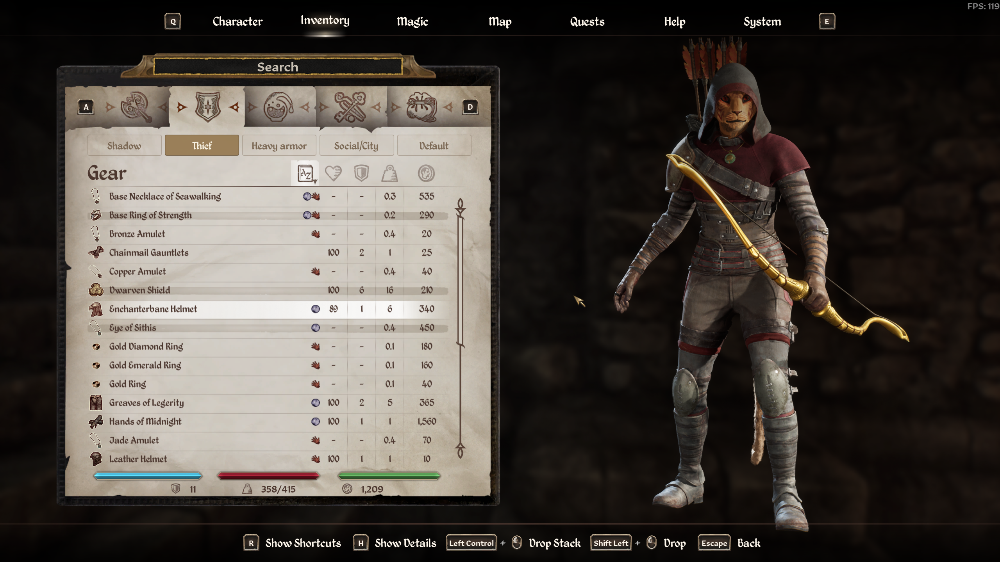

# Gear Loadouts

An OBSE64 plugin for **The Elder Scrolls IV: Oblivion Remastered** that lets you switch between 5 saved sets of worn gear with a single click.
A loadout only remembers what you were wearing, so the same item can be part of as many loadouts as you like.

## Features
- 5 loadouts: `Default` and `Loadout 1` - `Loadout 4`
- A row of buttons in the inventory menu
  - Left click switches to that loadout
  - Right click opens a popup to rename it (max. 15 characters, `Enter` saves, `Esc` cancels)
- Hotkeys: `Ctrl + Numpad 0` - `Ctrl + Numpad 4`
- Every equipped item is part of a loadout: armour, shields, clothing, rings, amulets, weapons, ammo and torches
- Pieces that are in both loadouts stay on, pieces that are no longer in your inventory are skipped
- Switching is blocked while something is fighting you
- Loadouts are saved per character

### How switching works
When switching from loadout A to B:
1) Everything you are wearing right now is saved as A
2) Everything B does not hold is taken off
3) Everything B holds that is still in your inventory is put on

Switching to a loadout for the first time takes everything off, since that loadout is still empty.

### Where the data lives
The loadouts are saved in `GearLoadouts.json` next to the DLL, keyed by the character's ID. They are not part of the save file (OBSE64 has no interface for that yet), so loading an older save keeps your newest loadouts.

Which loadout is active is part of the save: `GearLoadouts.esp` adds a hidden token item, and the player carries one more of it than the number of the active loadout. Loading an older save therefore brings back the loadout your gear in that save belongs to, and the next switch stores that gear in the right loadout. In a save without the token (made before the mod was installed, or without the `.esp`) no loadout is selected: the next switch puts the chosen loadout on without saving the gear you were wearing into any loadout.

## Installation
### Requirements
- [OBSE64](https://github.com/ianpatt/obse64) (tested with 0.2.2 on game version 1.512.105)
- Address Library for OBSE64
- Simple Loadout System has to be **disabled**, since both hook the same engine call

### Setup
1) Copy `GearLoadouts.dll` into `Oblivion Remastered\OblivionRemastered\Binaries\Win64\OBSE\Plugins\`
2) Copy `GearLoadouts.esp` into `Oblivion Remastered\OblivionRemastered\Content\Dev\ObvData\Data\` and add the line `GearLoadouts.esp` to `Plugins.txt` in that folder
3) Start the game through `obse64_loader.exe`

If something does not work, the log can be found at `Documents\My Games\Oblivion Remastered\OBSE\Logs\GearLoadouts.log`.
Every game start appends to the same file, so after a crash and restart the crashed session is still in it. Once the log grows past 50 MB, its oldest lines are removed until it is below 15 MB.

## Build
### Requirements
- Windows
- Visual Studio (Build Tools are enough) with MSVC and C++23 support
- [xmake](https://xmake.io)
- Git

### Building the project
1) `git clone --recursive https://github.com/Sokkero/OblivionLoadoutsMod.git`
   - Already cloned without `--recursive`? Run `git submodule update --init --recursive`
2) Run `xmake build GearLoadouts` from PowerShell in the project root
3) The DLL can be found in `build\windows\x64\releasedbg\GearLoadouts.dll`
4) The plugin is `data\GearLoadouts.esp`, generated by `python tools/make_esp.py`

## Credits
Parts of this project are adapted from [Simple Loadout System](https://github.com/ApocryphaRealm/SimpleLoadoutSystemOR) by ApocryphaRealm and [Menus Revamped](https://github.com/cfa911/Oblivion-Remastered---Mod---Menus-Revamped) by cfa911. Built on [CommonLibOB64](https://github.com/libxse/commonlibob64).
See `NOTICE.md` for the details.

## Licence
GPL-3.0-or-later, see `LICENSE`, `NOTICE.md` and `THIRD_PARTY_NOTICES.md`.
